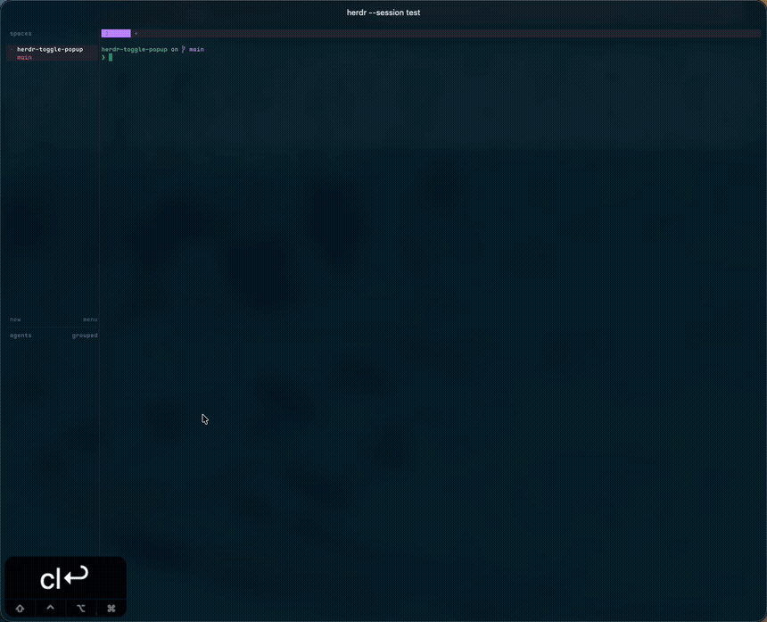

# herdr-toggle-popup

A [Herdr](https://herdr.dev) plugin that toggles a full-screen popup shell with one keybinding.



## Install

This plugin requires Herdr 0.9.3 or newer and `tmux` 3.4 or newer.

```bash
herdr plugin install maro114510/herdr-toggle-popup
```

Install `tmux` yourself if it is not already available:

```bash
brew install tmux
```

For local development, link the checkout and build the binary:

```bash
herdr plugin link .
sh scripts/build.sh
```

## Verify a release download

Releases built with attestation support include a signed GitHub Actions build-provenance attestation. Verify a downloaded binary before running it:

```bash
gh attestation verify ./toggle-popup_darwin_arm64 \
  --repo maro114510/herdr-toggle-popup \
  --signer-workflow maro114510/herdr-toggle-popup/.github/workflows/release.yml \
  --source-ref refs/tags/vX.Y.Z
```

| Flag | Checks |
| --- | --- |
| `--repo` | This repository owns the attestation. |
| `--signer-workflow` | This plugin's release workflow signed the attestation. |
| `--source-ref` | The build ran from the release tag, which must match `version` in [`herdr-plugin.toml`](./herdr-plugin.toml). Replace `vX.Y.Z` in the command with that tag. |
| `--source-digest` | The build ran from the source commit given by `$(git rev-parse vX.Y.Z^{commit})`. |

`gh attestation verify` recomputes the file digest and rejects an altered binary. Releases published before attestation support have no attestation, so verification fails.

## Inspect the bill of materials

Each release attaches one CycloneDX 1.6 JSON SBOM per distributed binary. [`syft`](https://github.com/anchore/syft), pinned by version and SHA-256 in the [release workflow](./.github/workflows/release.yml), reads the Go build information embedded in the binary, so the listed modules are the ones that binary contains, not what [`go.mod`](./go.mod) requests.

| Target | Binary | SBOM |
| --- | --- | --- |
| macOS amd64 | `toggle-popup_darwin_amd64` | `sbom_toggle-popup_darwin_amd64.cdx.json` |
| macOS arm64 | `toggle-popup_darwin_arm64` | `sbom_toggle-popup_darwin_arm64.cdx.json` |
| Linux amd64 | `toggle-popup_linux_amd64` | `sbom_toggle-popup_linux_amd64.cdx.json` |
| Linux arm64 | `toggle-popup_linux_arm64` | `sbom_toggle-popup_linux_arm64.cdx.json` |

List the modules and versions:

```bash
jq -r '.components[] | select(.type == "library") | "\(.name) \(.version)"' sbom_toggle-popup_darwin_arm64.cdx.json
```

Compare them with the binary's own record:

```bash
go version -m ./toggle-popup_darwin_arm64
```

Validate the document with the [CycloneDX CLI](https://github.com/CycloneDX/cyclonedx-cli), which the release job also runs:

```bash
cyclonedx validate --input-file sbom_toggle-popup_darwin_arm64.cdx.json \
  --input-format json --input-version 1.6 --fail-on-errors
```

The release job fails when an SBOM is missing, cannot be generated, or does not validate, so a published release carries all four.

## Binding a key

Copy the block from [`keybindings.toml`](./keybindings.toml) into `~/.config/herdr/config.toml`:

```toml
[[keys.command]]
key = "alt+l"
type = "plugin_action"
command = "maro114510.toggle-popup.toggle-shell"
description = "Toggle popup shell"
```

The key bound here also closes the popup.
Keep it consistent with `close_key`, described in [Close key](#close-key).

## Session behavior

The plugin uses Herdr's native full-screen `popup` placement. Herdr creates the child PTY at the popup's inner size after accounting for its border, so the final prompt line remains in the visible terminal surface.

The shell runs inside a named `tmux` session on a dedicated server, so tmux's default mouse bindings stay intact. While the popup is visible, the close key is handled by that session and detaches only its current client. It is `Alt+L` by default. Herdr closes the popup and the shell keeps running. Pressing the close key again opens a fresh native popup and resumes the same session. The tmux status line stays disabled, and mouse wheel and trackpad scrolling move the shell's output history.

Multiple clients can attach to one saved shell. A popup whose namespace, scope, and entrypoint match an existing session attaches to it as another tmux client instead of starting a second shell. The plugin sets the tmux `window-size` policy to `smallest`, so the shared window follows the smallest attached client and resizing any client resizes the window. When one popup closes, only that client detaches: the other clients and the shell keep running. Closing the last client leaves the saved session in place, and the next popup resumes the same shell.

### Mouse selection and the clipboard

The popup enables tmux mouse reporting, so a plain drag is tmux selection rather than Herdr native selection: releasing it fills the tmux buffer and, because the dedicated server runs with `set-clipboard external`, also writes the text to the outer terminal's clipboard. Herdr's own selection (`ui.copy_on_select`) only applies to panes whose application has not enabled mouse reporting, so it stays out of the popup.

`external` rather than `on` is deliberate: tmux still sends its own copies outward, but a pane-originated OSC52 sequence cannot create or overwrite a tmux buffer, which `on` would allow. The plugin sets the option on every connection, including a reattach.

This path requires tmux 3.4 or newer: tmux 2.9–3.3 crash on Linux with ncurses 6.4 when they emit the copy. The automated tests stop at the OSC52 sequence tmux writes to its client. To verify the last hop into the macOS clipboard, run the [host clipboard smoke test](./docs/smoke-test-clipboard.md) with a real popup and `pbpaste`.

A saved shell is keyed to its Herdr namespace, its scope, and its entrypoint, and it is reused whenever all three are unchanged. The namespace is the hash of `HERDR_SOCKET_PATH`, so the same workspace ID, tab ID, or focused-directory string in two Herdr instances (or two named sessions) opens two different saved shells instead of sharing one. `HERDR_SOCKET_PATH` must be set when the shell starts; if it is missing, the popup shows an error and never connects to tmux, rather than falling back to a shared, un-namespaced session.

Herdr permits one native popup at a time. Close any existing native popup before opening this shell.

To discard a saved popup shell session, use `tmux -L herdr-toggle-popup ls` and `tmux -L herdr-toggle-popup kill-session -t <session>`.

### Recovering sessions from earlier versions

Sessions created before the namespace was part of the identity do not carry a namespace, so the plugin never attaches to or deletes them automatically. Recover one by hand:

- On the dedicated server, list sessions with `tmux -L herdr-toggle-popup ls`, then `tmux -L herdr-toggle-popup attach -t <session>`.
- On the default server, list sessions with `tmux ls`, then `tmux attach -t <session>`.

Remove an unwanted legacy session on the server that holds it: `tmux -L herdr-toggle-popup kill-session -t <session>` on the dedicated server, or `tmux kill-session -t <session>` on the default server.

Neither v0.6.0 nor v0.7.0 removes a legacy session automatically. See [recover a legacy tmux session](./docs/legacy-overlay-removal.md#recover-a-legacy-tmux-session) for the full procedure and how to move its work to a native popup.

## Legacy overlay support removal

Legacy overlay support is deprecated in v0.6.0 and removed in v0.7.0. Native popups, saved tmux shells, and the `scope`, `close_key`, `width`, and `height` settings are unaffected.

| Release | Legacy overlay support |
| --- | --- |
| v0.6.0 | Announced and deprecated. The legacy commands still run, and `popup_size` and `popups.json` are still read. |
| v0.7.0 | Support ends. The legacy commands and `popup_size` are removed, and the `popups.json` registry is no longer read or written. |

The affected CLI, configuration, and state interfaces change as follows:

| Interface | v0.6.0 | v0.7.0 | Replacement |
| --- | --- | --- | --- |
| `toggle-popup gc` | Available; prunes stale `popups.json` entries | Removed; exits as an unknown command | None; native popups do not use a registry |
| `toggle-popup on-pane-closed` | Available as the legacy `pane.closed` event handler | Removed | None; native popups emit no pane lifecycle event |
| `toggle-popup on-tab-focused` | Available as the legacy `tab.focused` event handler | Removed | None; the close key closes the popup |
| `toggle-popup doctor` | Prints the `state:` line and the `popup_size entries` count | Prints neither; still prints the effective `popup size:` | None |
| `popup_size.<entrypoint>` or `[popup_size]` | Read but not used for native popup dimensions | Ignored | `width` and `height` |
| `HERDR_PLUGIN_STATE_DIR` / `popups.json` | Read by `toggle`, `doctor`, `gc`, and the event handlers | Never read or written; the file is left in place | None |

The plugin never deletes a legacy tmux session automatically. In v0.6.0 the toggle action closes a visible legacy overlay pane but leaves its tmux session and the `popups.json` file in place; v0.7.0 removes that guard. For the full schedule, migration steps, and separate recovery procedures, see the [legacy overlay removal release guidance](./docs/legacy-overlay-removal.md): [recover a legacy overlay](./docs/legacy-overlay-removal.md#recover-a-legacy-overlay) and [recover a legacy tmux session](./docs/legacy-overlay-removal.md#recover-a-legacy-tmux-session).

## Directory- and tab-scoped sessions

By default, the saved tmux shell session is scoped to the workspace. To scope it to the focused directory across workspaces, create `$HERDR_PLUGIN_CONFIG_DIR/config.toml` with:

```toml
scope = "directory"
```

Use `scope = "tab"` to scope it to a particular tab within a workspace. The popup process reads the invocation context so these scopes also work with native popup panes, which do not receive `HERDR_PANE_ID`.

### Directory identity is the exact cwd string

Inside one Herdr namespace, `scope = "directory"` shares one saved shell across every workspace and tab whose focused pane reports the same `focused_pane_cwd` string, and opens a separate shell for any other string. The plugin compares the string as reported: it does not clean the path, resolve symlinks, or fold case, so `/work/repo`, `/work/repo/`, `/work/REPO`, and a symlink alias of that directory are four identities. A namespace still separates Herdr instances, so the same string in two namespaces opens two shells.

## Close key

`close_key` in `$HERDR_PLUGIN_CONFIG_DIR/config.toml` sets the key that closes the popup.
It defaults to `M-l` and must name the same key as your Herdr binding in tmux syntax.

| Herdr config | Plugin config |
| --- | --- |
| `key = "alt+l"` | `close_key = "M-l"` |
| `key = "alt+p"` | `close_key = "M-p"` |

An invalid value or a name tmux does not know falls back to `M-l`.
Do not use the tmux prefix `C-b`.
Each saved session keeps the key it opened with, so two popups can close on `M-l` and `M-p` at once.
A changed key applies the next time the popup opens.

## Popup size

By default the popup fills the terminal. To open it at a different size, create `$HERDR_PLUGIN_CONFIG_DIR/config.toml` with:

```toml
width = "80%"
height = 20
```

`width` and `height` each accept either a percentage of the terminal area (`"80%"`, from 1% to 100%) or a number of terminal cells (`20`), and each defaults to `100%`. They set the popup's outer size, including its border, exactly as Herdr's own popup dimensions do, and Herdr clamps values below its minimum. An invalid value is ignored with a warning on stderr and falls back to `100%`.

These keys are independent of the legacy `popup_size.<entrypoint>` resize steps. Those steps were never used for native popup dimensions, are deprecated in v0.6.0, and are removed in v0.7.0; use `width` and `height` instead. See the [legacy overlay removal release guidance](./docs/legacy-overlay-removal.md).

## Invalid configuration

A `config.toml` that cannot be read or parsed is reported on stderr and the plugin continues with the defaults, so a broken file never blocks the toggle. A missing file is the normal opt-out and stays silent.

## Diagnostics

Run the doctor command when collecting support details:

```bash
"$HERDR_PLUGIN_ROOT/bin/toggle-popup" doctor
```

It prints the plugin, Herdr, and tmux versions; the Herdr namespace hash, scope, and saved-session name; the effective popup size and close key; and the tmux server, session, and client state.
For clipboard support it reports `mouse`, `set-clipboard`, and `window-size` as tmux actually has them, plus whether `TERM` and each attached client's terminal advertise the `Ms` capability tmux needs to send a selection to the outer terminal.
A missing server, session, tool, or context is reported on its own line and the remaining checks still run.

Diagnosis is read-only: it does not start a tmux server, change an option or binding, or touch a tmux buffer or the clipboard.

## License

[Apache License 2.0](./LICENSE)
