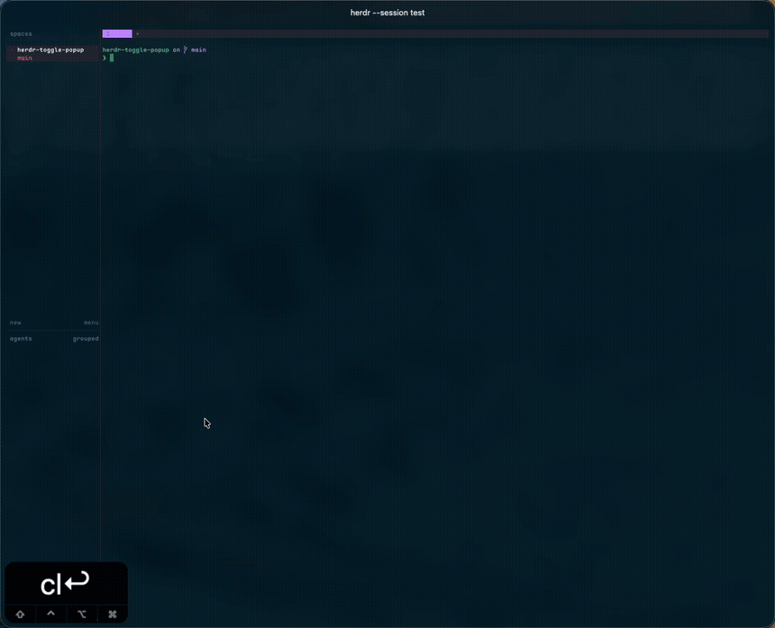

# herdr-toggle-popup

A [Herdr](https://herdr.dev) plugin that toggles a full-screen popup shell with one keybinding.



## Install

This plugin requires Herdr 0.9.3 or newer and `tmux` 2.9 or newer.

```bash
herdr plugin install maro114510/herdr-toggle-popup
```

Install `tmux` yourself if it is not already available:

```bash
brew install tmux
```

For local development, link the checkout and build the binary:

```bash
herdr plugin link .
sh scripts/build.sh
```

## Verify a release download

Releases built with attestation support include a signed GitHub Actions build-provenance attestation. Verify a downloaded binary before running it:

```bash
gh attestation verify ./toggle-popup_darwin_arm64 \
  --repo maro114510/herdr-toggle-popup \
  --signer-workflow maro114510/herdr-toggle-popup/.github/workflows/release.yml \
  --source-ref refs/tags/vX.Y.Z
```

| Flag | Checks |
| --- | --- |
| `--repo` | This repository owns the attestation. |
| `--signer-workflow` | This plugin's release workflow signed the attestation. |
| `--source-ref` | The build ran from the release tag, which must match `version` in [`herdr-plugin.toml`](./herdr-plugin.toml). Replace `vX.Y.Z` in the command with that tag. |
| `--source-digest` | The build ran from the source commit given by `$(git rev-parse vX.Y.Z^{commit})`. |

`gh attestation verify` recomputes the file digest and rejects an altered binary. Releases published before attestation support have no attestation, so verification fails.

## Binding a key

Copy the block from [`keybindings.toml`](./keybindings.toml) into `~/.config/herdr/config.toml`:

```toml
[[keys.command]]
key = "alt+l"
type = "plugin_action"
command = "maro114510.toggle-popup.toggle-shell"
description = "Toggle popup shell"
```

## Session behavior

The plugin uses Herdr's native full-screen `popup` placement. Herdr creates the child PTY at the popup's inner size after accounting for its border, so the final prompt line remains in the visible terminal surface.

The shell runs inside a named `tmux` session on a dedicated server, so tmux's default mouse bindings stay intact. While the popup is visible, `Alt+L` is handled by that session and detaches only its current client. Herdr closes the popup and the shell keeps running. Pressing `Alt+L` again opens a fresh native popup and resumes the same session. The tmux status line stays disabled, and mouse wheel and trackpad scrolling move the shell's output history.

### Mouse selection and the clipboard

The popup enables tmux mouse reporting, so a plain drag is tmux selection rather than Herdr native selection: releasing it fills the tmux buffer and, because the dedicated server runs with `set-clipboard external`, also writes the text to the outer terminal's clipboard. Herdr's own selection (`ui.copy_on_select`) only applies to panes whose application has not enabled mouse reporting, so it stays out of the popup.

`external` rather than `on` is deliberate: tmux still sends its own copies outward, but a pane-originated OSC52 sequence cannot create or overwrite a tmux buffer, which `on` would allow. The plugin sets the option on every connection, including a reattach.

A saved shell is keyed to its Herdr namespace, its scope, and its entrypoint, and it is reused whenever all three are unchanged. The namespace is the hash of `HERDR_SOCKET_PATH`, so the same workspace ID, tab ID, or focused-directory string in two Herdr instances (or two named sessions) opens two different saved shells instead of sharing one. `HERDR_SOCKET_PATH` must be set when the shell starts; if it is missing, the popup shows an error and never connects to tmux, rather than falling back to a shared, un-namespaced session.

Herdr permits one native popup at a time. Close any existing native popup before opening this shell.

To discard a saved popup shell session, use `tmux -L herdr-toggle-popup ls` and `tmux -L herdr-toggle-popup kill-session -t <session>`.

### Recovering sessions from earlier versions

Sessions created before the namespace was part of the identity do not carry a namespace, so the plugin never attaches to or deletes them automatically. Recover one by hand:

- On the dedicated server, list sessions with `tmux -L herdr-toggle-popup ls`, then `tmux -L herdr-toggle-popup attach -t <session>`.
- On the default server, list sessions with `tmux ls`, then `tmux attach -t <session>`.

Remove an unwanted legacy session on the server that holds it: `tmux -L herdr-toggle-popup kill-session -t <session>` on the dedicated server, or `tmux kill-session -t <session>` on the default server.

## Directory- and tab-scoped sessions

By default, the saved tmux shell session is scoped to the workspace. To scope it to the focused directory across workspaces, create `$HERDR_PLUGIN_CONFIG_DIR/config.toml` with:

```toml
scope = "directory"
```

Use `scope = "tab"` to scope it to a particular tab within a workspace. The popup process reads the invocation context so these scopes also work with native popup panes, which do not receive `HERDR_PANE_ID`.

## Popup size

By default the popup fills the terminal. To open it at a different size, create `$HERDR_PLUGIN_CONFIG_DIR/config.toml` with:

```toml
width = "80%"
height = 20
```

`width` and `height` each accept either a percentage of the terminal area (`"80%"`, from 1% to 100%) or a number of terminal cells (`20`), and each defaults to `100%`. They set the popup's outer size, including its border, exactly as Herdr's own popup dimensions do, and Herdr clamps values below its minimum. An invalid value is ignored with a warning on stderr and falls back to `100%`.

These keys are independent of the legacy `popup_size.<entrypoint>` resize steps, which are not used for native popup dimensions.

## Diagnostics

Run the doctor command when collecting support details:

```bash
"$HERDR_PLUGIN_ROOT/bin/toggle-popup" doctor
```

## License

[Apache License 2.0](./LICENSE)
